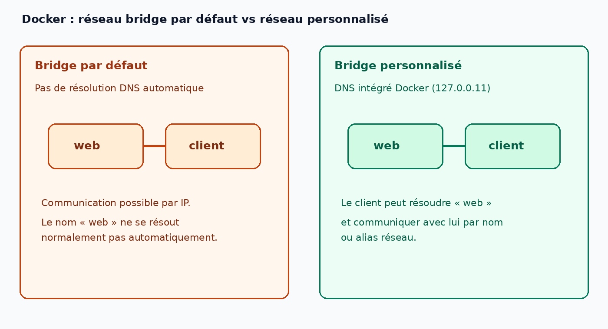
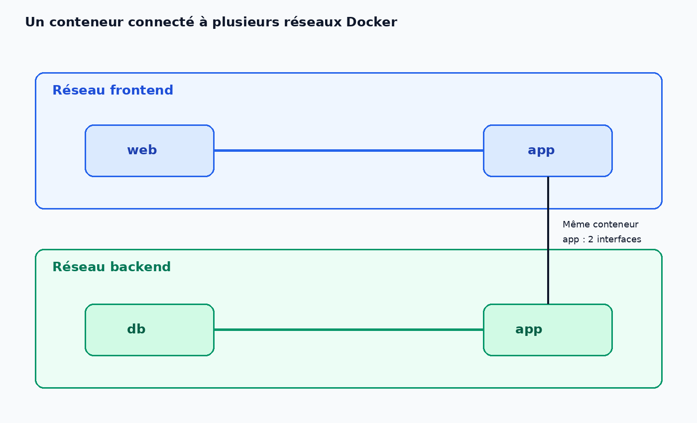

# Notes Docker

## Commandes utiles

| Commande | Rôle |
|---|---|
| `docker pull <image>` | télécharger une image depuis un registre |
| `docker images` | lister les images locales |
| `docker run --rm <image> <cmd>` | lancer un conteneur, le supprimer quand il s'arrête |
| `docker run -it --name <n> <image> sh` | shell interactif dans un conteneur nommé |
| `docker ps -a` | lister tous les conteneurs, y compris arrêtés |
| `docker rm <name>` | supprimer un conteneur arrêté |

## Concepts

### Général

- **Image** : modèle en lecture seule (comme un programme).
- **Conteneur** : instance d'une image qui tourne (comme un processus). Plusieurs conteneurs peuvent venir d'une même image.
- **Registre** : serveur qui stocke et distribue des images (Docker Hub est le registre public par défaut ; aussi GHCR, AWS ECR).
- Les données d'un conteneur vivent dans une couche modifiable : elles survivent à l'arrêt (`exit`) et sont supprimées par `docker rm`.

### Dockerfile

- `FROM` : l'image de base sur laquelle on construit (ici `python:3.12-slim`).
- `WORKDIR` : le dossier de travail dans l'image. Il est créé s'il n'existe pas, et les instructions suivantes s'y exécutent.
- `COPY` : copie des fichiers de ma machine vers l'image.
- `RUN` : exécute une commande pendant la construction de l'image (ex. `pip install`). Le résultat est enregistré dans une couche.
- `CMD` : commande par défaut au démarrage du conteneur. Elle ne s'exécute pas pendant la construction, et on peut la remplacer au lancement.

> [!NOTE]
> **Règle de cache :** Quand une étape change, Docker refait
> cette étape et toutes celles qui la suivent. On place donc
> en haut ce qui change rarement (les dépendances) et en bas
> ce qui change souvent (le code).
>
> Mesure : 17,6 s avec `COPY` de tout d'un coup avant `pip install`, 6,2 s avec `requirements.txt` copié avant `pip install` et `main.py` après.

Commandes : [docker-demo](../labs/docker-demo)

```sh
docker build -t demo:1 .
docker run --rm demo:1
docker run --rm -e NAME=Karim demo:1
docker run --rm demo:1 pwd
```

- `-t demo:1` : donne le nom `demo` et le tag `1` à l'image.
- `.` : le contexte de build, c'est-à-dire le dossier envoyé à Docker pour construire l'image.
- `-e NAME=Karim` : passe la variable d'environnement `NAME` au conteneur.
- `pwd` : remplace la `CMD` du Dockerfile, donc `main.py` ne se lance pas ; le conteneur affiche `/app` (le `WORKDIR`) puis s'arrête.

### Volumes

- **Volumes** : espaces de stockage de données persistantes
  pour conteneurs, créés et gérés par Docker.
- **Bind Mount** : Un fichier ou un répertoire de la machine
  hôte est monté depuis l'hôte dans un conteneur.

```sh
docker volume create data0
docker volume ls
docker volume rm data0
docker volume inspect data0
docker run --rm -v data0:/data alpine:latest '<cmd>'
docker run --rm -v /chemin/hote:/data alpine:latest '<cmd>'   # bind mount
```

### Réseaux

- `bridge` par défaut : communication surtout par IP ; pas
  de DNS automatique entre conteneurs par nom.
- Réseau bridge personnalisé : DNS Docker intégré (ex.
  `127.0.0.11`) ; communication par nom/alias.
- Un conteneur peut rejoindre plusieurs réseaux : chaque
  réseau connecté ajoute une interface réseau au conteneur.
- Les réseaux permettent d'isoler les communications
  (frontend, backend, database).

```sh
docker network ls
docker network create -d bridge br0
docker run --name cont0 -itd --network br0 alpine
docker run --name cont1 -itd alpine
docker exec -it cont0 sh
docker network connect br0 cont1
docker network prune
```




### Ports

En créant une correspondance (mapping) de ports entre l'hôte
et son conteneur, d'autres applications ou machines peuvent
accéder aux services du conteneur.

- Réseau : qui peut parler au conteneur à l'intérieur de Docker.
- Port : comment l'atteindre depuis l'extérieur.

```sh
docker run -dit -p 8080:80 nginx:alpine
curl http://localhost:8080
```

- 8080 : port de la machine hôte
- 80 : port du conteneur

> [!NOTE]
> **Un point de sécurité à retenir :** `-p 8080:80` ouvre le port
> `8080` sur toutes les interfaces de la VM, donc d'autres
> machines du réseau peuvent l'atteindre. Pour limiter l'accès
> à la VM seule, écris `-p 127.0.0.1:8080:80`.

## Problèmes rencontrés

### `pip install` échoue pendant le build

- **Erreur :** `Temporary failure in name resolution` à l'étape `RUN pip install`.
- **Cause :** le second DNS de la VM est une adresse IPv6. Les conteneurs n'ont pas d'IPv6 par défaut, donc ils ne peuvent pas l'atteindre. La VM, elle, résolvait bien les noms.
- **Test :** `docker run --rm alpine nslookup pypi.org` expirait, alors que `ping 8.8.8.8` depuis le conteneur marchait (réseau OK, DNS cassé).
- **Correction :** dans `/etc/docker/daemon.json` :
  ```json
  { "dns": ["1.1.1.1", "8.8.8.8"] }
  ```
  puis `sudo systemctl restart docker`. Ce fichier configure la VM, il ne va pas dans le dépôt.

### `-v data0` sans `:`

Avec une seule valeur, Docker crée un volume anonyme monté sur `/data0`, au lieu d'utiliser le volume nommé `data0`.

```sh
docker run --rm -it -v data0 alpine          # volume anonyme sur /data0
docker run --rm -it -v data0:/data alpine    # volume data0 sur /data
```

Règle : `docker run -v [VOLUME]:[POINT DE MONTAGE] [IMAGE]`

### Le conteneur s'arrête après `attach`

`docker attach` se connecte au programme principal (`sh`). Quand on le quitte, le conteneur s'arrête.

- Pour ouvrir un shell sans risque : `docker exec -it <nom> sh`.
- Pour quitter un `attach` sans arrêter le conteneur : Ctrl+P puis Ctrl+Q.
